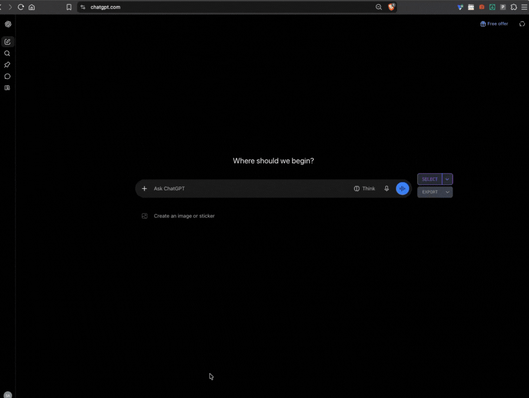

# PerTabMood

**Every tab, its own mood.**

Ever wanted to read one website in light mode while keeping the rest of your browser in dark mode?

**PerTabMood lets each browser tab have its own light/dark theme preference.** Switch one tab to light mode without affecting the others. Even two tabs displaying the same website can use different themes.

Unlike color-inversion extensions, PerTabMood uses the Chromium Debugger API to emulate `prefers-color-scheme`, allowing websites to render their own native themes.

## Features

- **Independent per-tab themes** — Switch one tab between light and dark mode without affecting other tabs.
- **Native theme rendering** — Emulates the tab's `prefers-color-scheme` preference so websites can render their own light or dark themes.
- **No color inversion** — Does not rely on color filters or forced recoloring.
- **Remembers your choice** — Stores each tab's theme preference locally while the tab remains open.

## Quick start

1. Open a supported website.
2. Click the PerTabMood extension icon.
3. Toggle the tab's theme between light and dark.
4. Switch to another tab and choose its theme independently.

For the best results, set the website's theme to **System**, **Automatic**, or **Follow system settings**.

## Installation

PerTabMood is currently installed manually as an unpacked browser extension.

1. Download or clone this repository.
2. Open your browser's extensions page:
   - **Chrome:** `chrome://extensions`
   - **Brave:** `brave://extensions`
   - **Other Chromium browsers:** Open the browser's extensions page.
3. Enable **Developer mode**.
4. Click **Load unpacked**.
5. Select the PerTabMood project folder containing `manifest.json`.
6. Open a supported website and click the PerTabMood extension icon.

## How it works

PerTabMood uses the Chromium Debugger API to emulate `prefers-color-scheme` for the selected tab.

1. **Popup** — Displays the current tab's theme preference and lets you toggle it.
2. **Background service worker** — Handles theme changes and coordinates communication with the browser.
3. **Debugger API** — Applies the selected `prefers-color-scheme` value to the target tab.
4. **Local storage** — Saves each tab's selected theme and restores the override when the page loads again while the tab remains open.

For example:

| Browser tab | Theme preference |
|---|---|
| GitHub | Dark |
| ChatGPT — Tab A | Dark |
| ChatGPT — Tab B | Light |

PerTabMood changes the theme preference received by the website rather than simply recoloring the page. The website must support `prefers-color-scheme` for the override to affect its appearance.

## Important: Website theme settings

PerTabMood works best on websites whose theme is set to **System**, **Automatic**, or **Follow system settings**.

If a website has its own theme setting, that setting may take priority over the browser preference. For example, if ChatGPT is explicitly set to Light mode, switching the tab's preference to Dark mode may not change the website's appearance.

**To let PerTabMood control the appearance, set the website's theme to follow system settings.**

## Permissions

PerTabMood requests the following browser permissions:

- **Debugger API (`debugger`)** — Emulates the selected tab's `prefers-color-scheme` preference.
- **Tabs API (`tabs`)** — Identifies the active tab and manages its theme state.
- **Storage API (`storage`)** — Saves theme preferences locally.
- **Host permissions (`<all_urls>`)** — Allows the extension's content script to run on websites across different domains.

When PerTabMood attempts to connect to a tab, the browser may display a warning such as **"PerTabMood started debugging this browser."** This is expected because the extension uses the Debugger API to apply the theme override.

Allow the connection if you want to use the feature. If you deny access, the override cannot be applied.

PerTabMood changes the selected tab's emulated theme preference, not your operating system's global light/dark setting.

## Security and privacy

PerTabMood runs locally in your browser. **The extension's code does not upload your data to the cloud or send data to an external server.**

- Theme preferences are saved locally using the browser's `storage.local` API.
- Theme changes are applied to the selected tab through the Chromium Debugger API.
- No account or cloud service is required.

PerTabMood requests access to website tabs so it can apply the theme preference. Review the permissions above and install the extension only if you are comfortable granting that access.

## Browser compatibility

PerTabMood is designed for Chromium-based browsers that provide the required Debugger API, including:

- Google Chrome
- Brave
- Other compatible Chromium-based browsers

Safari is not supported because it does not provide the required API for this per-tab override.

## Troubleshooting

- **The theme does not change:** Check the extension's status message, make sure the website follows system settings, and try refreshing the page.
- **Debugger connection fails:** Close DevTools for the affected tab and try again. Browsers generally allow only one debugger connection per tab.
- **Browser blocks debugger access:** Allow the connection when prompted. Browser settings or policies may also prevent debugger access.
- **Unsupported page:** Browser-internal pages (such as `chrome://...`), extension pages, and the Chrome Web Store cannot be controlled.
- **The override is gone:** Closing a tab removes its saved theme preference.

## Tech stack

- JavaScript
- Chrome Extensions Manifest V3
- Chromium Debugger API
- Chrome Extension APIs (`tabs`, `storage`, `runtime`)
- CSS `prefers-color-scheme` media feature
